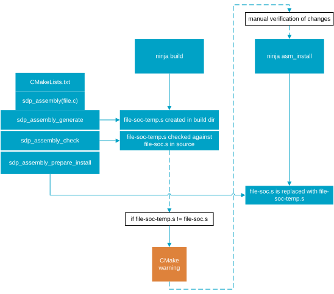

.. _hpf_assembly_management:

Assembly management
###################

.. contents::
   :local:
   :depth: 2

.. caution::

   The High-Performance Framework (HPF) support in the |NCS| is :ref:`experimental <software_maturity>` and is limited to the nRF54L15, nRF54LM20, nRF54LC10A, and nRF54LV10A devices.

Assembly management is a critical component in the development process, particularly when meeting the modularity and testability requirements defined in the :ref:`hpf_event_handling`.

Overview
********

Emulating communication protocols requires precise timing.
To manage this, you must separate the time-sensitive parts of the code, known as Hard Real-Time (HRT) components.
These components have strict timing requirements and are stored in a pre-compiled assembly format to ensure they remain unchanged.

The assembly management CMake functions are integrated into the build process and are executed with every build.
These functions check for any modifications that could lead to the generation of different assembly files, such as changes in HRT source files or the compiler used.
Detecting these changes is essential because they can impact the timing accuracy of software peripherals.
If any changes are detected that could affect the assembly files, you must verify that these differences are within acceptable limits.
This ensures that the new code maintains the necessary timing accuracy.

To use this feature, you must include the command ``hpf_assembly_install(app "${CMAKE_SOURCE_DIR}/file.c")`` in your application's :file:`CMakeLists.txt` file, where ``file.c`` value is the C file containing only Hard Real-Time (HRT) functions.

Although the assembly management functions are called every time in build time, some of them can also be run independently by using CMake targets in VPR core's application build directory.

See the following flow of the build-time assembly management process:

.. _hpf_assembly_management_cmake:

Implementation
**************

The assembly management performed at build time uses following :ref:`CMake<cmake_options>` functions:

* :c:func:`hpf_assembly_generate`
* :c:func:`hpf_assembly_check`
* :c:func:`hpf_assembly_prepare_install`
* :c:func:`hpf_assembly_target_sources`

hpf_assembly_generate
=====================

The :c:func:`hpf_assembly_generate` function creates a build target (asm_gen) that generates a temporary assembly file from HRT source files.
This files is named :file:`file-soc-temp.s` and is located in the Fast Lightweight Peripheral Processor (FLPR) application's build directory when running ``ninja build``.
In the filename, *soc* represents the System on Chip (SoC) name used in the current build, such as ``nrf54l15`` or ``nrf54lm20a``.

hpf_assembly_check
==================

The :c:func:`hpf_assembly_check` function sets up a build target (asm_check) that is triggered when executing ``ninja build``, following the :c:func:`sdk_assembly_generate` function.
The target verifies if the :file:`file-soc-temp.s` file in the build directory matches the :file:`file-soc.s` file in the source directory.
If discrepancies are found, it triggers a CMake error (in user mode) or warning (in developer mode).

hpf_assembly_prepare_install
============================

The :c:func:`hpf_assembly_prepare_install` function creates a build target (asm_install) that generates the :file:`file-soc-temp.s` file in the build directory and replaces the :file:`file-soc.s` file in the source directory with it.

hpf_assembly_target_sources
===========================

The :c:func:`hpf_assembly_target_sources` function includes the :file:`file-soc.s` from source directory (user mode) or the :file:`file-soc-temp.s` from build directory (developer mode) in the target sources.

Configuration
*************

You can change the mechanism of :c:func:`hpf_assembly_check` and :c:func:`hpf_assembly_target_sources` functions by switching between user and developer build modes:

* User mode - The application uses a pre-generated assembly file to construct the HRT component.
* Developer mode -  The application employs a newly generated assembly file.
  This approach not only facilitates the integration of updates but also allows for a thorough review of changes made by developers and modifications introduced by the toolchain.
  You can enable it by setting the :kconfig:option:`SB_CONFIG_HPF_DEVELOPER_MODE` Kconfig option, when building for the application core, or :kconfig:option:`CONFIG_HPF_DEVELOPER_MODE`, when building for the FLPR core only.
  If this setting is disabled, files are built in the user mode.

Verifiying assembly files and managing updates
==============================================

When working in user or developer mode, you must verify the integrity and accuracy of assembly files:

* In user mode, if you receive a CMake error from asm_check, evaluate if the differences between :file:`file-soc-temp.s` and :file:`file-soc.s` are minimal and maintain the required timing accuracy.
  Depending on the outcome, do the following:

  * If the differences are acceptable, use the :ref:`west ncs-hpf-asm-update <hpf_assembly_management_west>` command to update the assembly files for all supported SoCs.
    To update only the assembly files of your build, execute the ``ninja asm_install`` command in the FLPR application's build directory.
  * If the differences are significant, investigate and adjust the code, or re-run hardware characterization tests to ensure compliance with the required specifications.

* In developer mode, if you wish to update the source directory with newly generated assembly files, invoke the ``ninja asm_install`` command in the ``build/hpf`` directory.

.. _hpf_assembly_management_west:

Updating assembly files for all SoCs
====================================

A change in the HRT source files, in the headers they include, or in the toolchain usually requires regenerating the assembly files for every supported SoC.
The ``west ncs-hpf-asm-update`` command automates this process for the HPF applications in the :file:`applications/hpf` directory.

For each application and for each SoC listed in the application's :file:`sample.yaml` file, the command configures the FLPR image in developer mode in a temporary build directory, builds the asm_gen target, and replaces the :file:`file-soc.s` file in the source directory if the newly generated assembly differs from it.
If the :file:`file-soc.s` file does not exist yet, for example when adding support for a new SoC, the command creates it.
The command uses the snippets required by the matching :file:`sample.yaml` scenario.
It fails if the toolchain is not the Zephyr SDK version specified in the :file:`zephyr/SDK_VERSION` file, unless you use the ``--force`` option.

Run the command from the |NCS| workspace:

.. code-block:: console

   west ncs-hpf-asm-update

The following options are commonly used:

* ``--check`` - Reports outdated or missing assembly files without modifying the source directory, and fails if any are found.
* ``--soc SOC`` - Processes only the given SoC, for example ``nrf54l15``.
* ``APP_DIR`` - Processes only the given application directory, for example :file:`nrf/applications/hpf/mspi`.
* ``--board BOARD`` - Builds the given board target instead of the platforms listed in :file:`sample.yaml`, for example for an application outside of the |NCS|.
* ``--list`` - Lists the applications and board targets to process without building them.
* ``-j JOBS`` - Runs the given number of builds in parallel.

Run ``west ncs-hpf-asm-update --help`` for the full list of options.
After updating the assembly files, review the changes with ``git diff`` and verify that the timing requirements are still met, as described in `Verifiying assembly files and managing updates`_.

Running CMake targets
*********************

There are three CMake targets that can be executed:

* asm_gen - Generates new assembly files out of HRT source files.
  This target is established by the :c:func:`hpf_assembly_generate` function.
* asm_check - Checks if newly generated assembly files differ from the existing ones and prints the result to the console.
  This target is established by the :c:func:`hpf_assembly_check` function.
* asm_install - Generates new assembly files and replaces the assembly files in the source directory with them.

You must run all assembly management CMake targets in the VPR application's build directory. They can be executed using the command ``ninja target_name``.
For example, to run the asm_install target, you would use the command ``ninja asm_install``.
