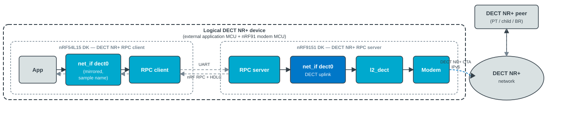
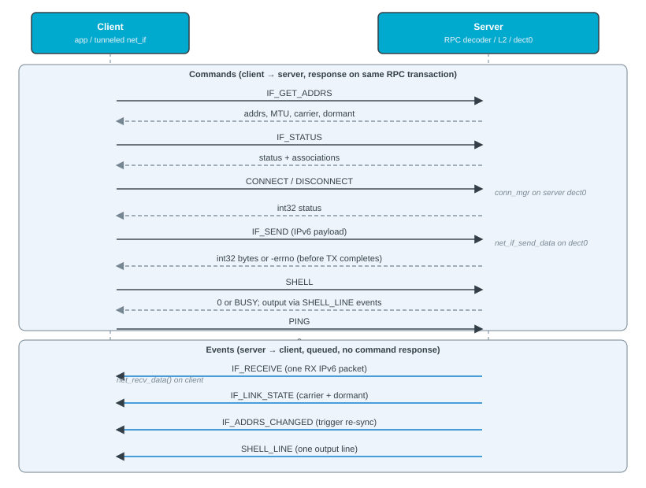

.. _dect_rpc:

DECT NR+ RPC
############

.. contents::
   :local:
   :depth: 2

The DECT NR+ RPC library lets an external MCU (without a DECT NR+ modem) use a Zephyr ``net_if`` and DECT NR+ shell commands served by the full :ref:`ug_dect` stack on an nRF91 Series device over :ref:`nrf_rpc` (typically UART).

.. note::
   The current implementation is :ref:`experimental <software_maturity>`.

Overview
********

Run the DECT NR+ modem and L2 on the nRF91 Series device (server role) and your application on another MCU (client role).
The client gets a tunneled ``net_if`` without integrating the modem on that chip.
You need two boards and must accept UART latency and throughput limits compared with a single-chip design (see the :ref:`dect_rpc_sample`).

The library serializes IPv6 packets, shell commands, and link or address notifications over the transport.
Use it when the application runs on a separate MCU while the DECT NR+ modem and stack stay on the nRF91 Series device.

Implementation
==============

The library has a client role, a server role, and shared RPC group code:

* Client (external MCU, no DECT NR+ modem) - Tunneled Zephyr ``net_if`` (DECT RPC L2; sample name ``dect0`` through the :kconfig:option:`CONFIG_DECT_NR_RPC_CLIENT_IFACE_NAME` Kconfig option).
* Server (nRF91) - DECT NR+ L2 and modem driver decode RPC, inject TX into L2, and mirror RX, link state, and addresses to the client.

Architecture
------------

The following figure shows a logical DECT NR+ device split across an external MCU (application and mirrored ``net_if``) and nRF9151 DK (modem and server ``dect0``), with the over-the-air DECT IPv6 network outside that boundary.
Example wiring uses nRF54L15 DK and nRF9151 DK from the :ref:`dect_rpc_sample`.
Other external MCU and the nRF91 Series device pairs behave the same way.

   Client and server boards and UART RPC link (see body text for data path).

RPC messages
------------

The client sends blocking commands with a response where applicable.
The server sends queued events without a command-style reply.
Command and event names are the ``DECT_RPC_CMD_*`` constants in the :file:`subsys/net/dect/rpc/common/dect_rpc_ids.h` file (internal; not in the public API headers).
The following figure lists them by direction.
The rest of this page refers to the ones that matter for bring-up and data path behavior.

Application IPv6 traffic uses ``DECT_RPC_CMD_IF_SEND`` (positive response = accepted byte count, negative = errno).
For that command, the RPC response is returned before the blocking DECT transmit completes on the server.
Client event decoders call the :c:func:`nrf_rpc_decoding_done` function so the transport can receive the next frame.

   RPC commands (client to server) and events (server to client).

Server L2 integration
---------------------

On the server, received IPv6 frames are handled in the :c:func:`dect_net_l2_recv` function in the :file:`subsys/net/dect/l2/dect_net_l2.c` file, not in the modem RX driver alone.

When an RPC client session is active (refreshed on client commands, cleared after :kconfig:option:`CONFIG_DECT_NR_RPC_SERVER_CLIENT_IDLE_TIMEOUT_SEC` or RPC re-bind), L2 forwards RX to the client through the :c:func:`dect_net_l2_rpc_forward_register` and :c:func:`dect_net_l2_rpc_client_set_connected` functions instead of processing the packet locally on ``dect0``.
When no session is active, the server handles packets on ``dect0`` as usual.

Link-state and IPv6 address or prefix changes on server ``dect0`` use the :c:func:`dect_net_l2_link_state_register` function and are mirrored with ``DECT_RPC_CMD_IF_LINK_STATE`` and ``DECT_RPC_CMD_IF_ADDRS_CHANGED`` events.

For ``DECT_RPC_CMD_IF_SEND``, the server builds a :c:struct:`net_pkt` structure on the DECT interface, derives the DECT destination from the IPv6 destination, and injects the packet with the :c:func:`net_if_send_data` function.

Client network interface
------------------------

The client does not build DECT NR+ L2 or the modem driver.
It registers DECT RPC L2 (``DECT_RPC_L2``) and a tunneled ``net_if`` only (sample default name ``dect0``).

During ``net_if`` initialization, the client sets the :c:enumerator:`NET_IF_IPV6_NO_ND` interface flag on the tunneled interface so the Zephyr stack does not run IPv6 Neighbor Discovery locally.
Neighbor Discovery and address management stay on the server ``dect0`` interface.
The client applies addresses, prefixes, MTU, carrier, and dormant state from ``DECT_RPC_CMD_IF_GET_ADDRS`` and ``DECT_RPC_CMD_IF_LINK_STATE`` RPC events instead.

With the :kconfig:option:`CONFIG_NET_IPV6_MLD` Kconfig option set, multicast behavior aligns with native DECT where applicable (including optional deferred join of ``ff02::fb`` when carrier is up).
Use different hostnames on the client and server so that the client does not impersonate the server's mDNS identity on the DECT side.

Requirements
************

The library requires the following:

* :ref:`nrf_rpc` (:kconfig:option:`CONFIG_NRF_RPC`, :kconfig:option:`CONFIG_NRF_RPC_CBOR`)
* IPv6 networking (:kconfig:option:`CONFIG_NET_IPV6`) on both client and server
* DECT NR+ L2 (:kconfig:option:`CONFIG_NET_L2_DECT`) and a DECT NR+ modem driver on the server only

.. _dect_rpc_configuration:

Configuration
*************

Enable :kconfig:option:`CONFIG_DECT_NR_RPC` and select the role on each image (``DECT NR+ over RPC role`` in menuconfig):

* :kconfig:option:`CONFIG_DECT_NR_RPC_CLIENT` - External MCU (mirrored ``net_if``, no DECT NR+ modem)
* :kconfig:option:`CONFIG_DECT_NR_RPC_SERVER` - An nRF91 Series device with :kconfig:option:`CONFIG_NET_L2_DECT` and modem

Connect the boards with UART :ref:`nrf_rpc`.
Enable the :kconfig:option:`CONFIG_NRF_RPC_UART_TRANSPORT` Kconfig option, set the ``chosen`` property ``nordic,rpc-uart`` to the UART node used for RPC on each board, and select :kconfig:option:`CONFIG_DECT_NR_RPC_UART_TRANSPORT` on both images.
The tunneled client ``net_if`` and server RPC bridge (:kconfig:option:`CONFIG_DECT_NR_RPC_NET_IF`, default enabled) must stay enabled on both images for the usual client or server link.
See :ref:`nrf_rpc` for UART buffer sizes, group init initiator, and response timeout (the :file:`prj.conf` and :file:`server.conf` files of the :ref:`dect_rpc_sample` show typical values).

Client image (:file:`prj.conf`):

* :kconfig:option:`CONFIG_DECT_NR_RPC_CLIENT_IFACE_NAME` - Logical name for the tunneled interface (sample: ``dect0``)
* :kconfig:option:`CONFIG_DECT_NR_RPC_CONN_MGR` - ``dect connect`` or ``dect disconnect`` proxied to server ``dect0``
* :kconfig:option:`CONFIG_DECT_NR_RPC_CLIENT_SHELL` - ``dect status``, ``dect sync``, ``dect run``, and related commands

Server image (:file:`server.conf`):

* :kconfig:option:`CONFIG_DECT` and DECT NR+ modem or L2 stack (see sample)
* :kconfig:option:`CONFIG_DECT_NR_RPC_SHELL` - Remote L2 shell over RPC (``dect run`` on the client)
* :kconfig:option:`CONFIG_NET_L2_DECT_CONN_MGR` and related ``CONFIG_NET_L2_DECT_CONN_MGR_*`` options - Association policy on real ``dect0`` (not on the client tunnel)

Optional client fragments in the sample tree (:file:`ping.conf`, :file:`dns.conf`, :file:`rpc-large-rx.conf`) add ping, DNS, or larger UART RX buffers.
They do not change the core RPC role options.

All other ``CONFIG_DECT_NR_RPC_*`` symbols (auto-sync timing, max tunneled IPv6 size, server event queue, idle session timeout, shell RPC init when :kconfig:option:`CONFIG_NRF_RPC_INIT` is off, logging) are documented in the :file:`subsys/net/dect/rpc/Kconfig` file.

Usage
*****

Bring-up matches the :ref:`dect_rpc_sample` sample (the sample calls the :c:func:`nrf_rpc_init` function from application code rather than relying on the :kconfig:option:`CONFIG_NRF_RPC_INIT` Kconfig option).

Boot order
==========

Reset the client first until it waits for the server, then reset the server.
On the server, call the :c:func:`nrf_modem_lib_init` function before :c:func:`nrf_rpc_init` on both sides.

Client steps
============

The tunneled interface name comes from the :kconfig:option:`CONFIG_DECT_NR_RPC_CLIENT_IFACE_NAME` Kconfig option (sample ``dect0``).
Complete the following steps to bring up the client:

#. Register an nRF RPC group-bound callback through the :c:func:`nrf_rpc_set_bound_handler` function, call :c:func:`nrf_rpc_init`, and wait until the callback reports that the group from :c:func:`dect_rpc_client_get_group` is bound to the server.
#. Call the :c:func:`dect_rpc_client_notify_rpc_init_done` function so that :kconfig:option:`CONFIG_DECT_NR_RPC_AUTO_SYNC` can pull addresses from the server and bring the interface up (or run ``dect sync`` manually if auto-sync is off).
#. Use the Zephyr networking APIs on the interface or ``dect`` shell commands (``dect status``, ``dect sync``, ``dect connect``, ``dect run <subcmd> [args...]``).
   Use ``dect status`` instead of ``dect run status`` for status.

Server steps
============

Call first the :c:func:`nrf_modem_lib_init` function, then :c:func:`nrf_rpc_init`.
Real DECT traffic uses modem ``dect0`` (see the :file:`server.conf` file).

Shell over RPC
==============

When the :kconfig:option:`CONFIG_DECT_NR_RPC_SHELL` and :kconfig:option:`CONFIG_DECT_NR_RPC_CLIENT_SHELL` Kconfig options are enabled, the client can run DECT NR+ L2 shell subcommands on the server using ``dect run <subcmd> [args...]``.
The command RPC response carries status only (0 OK, 1 error or ``BUSY``).
The printable output arrives in the ``DECT_RPC_CMD_SHELL_LINE`` events on the client.
If the server's local shell is running a DECT command, the RPC shell returns ``BUSY`` (the local shell always wins).

Use ``dect status`` (``DECT_RPC_CMD_IF_STATUS``) and ``dect sync`` for structured status and address sync.
Use the ``ping`` shell command on the client ``dect0`` interface (:file:`ping.conf`) instead of ``dect run ping``.

Samples using the library
*************************

The :ref:`dect_rpc_sample` in the |NCS| sample uses this library.

Limitations
***********

The library has the following limitations:

* Only one client at a time can be connected to a server.
* When a client is connected, the server no longer performs local child or multicast routing on ``dect0`` for packets forwarded to the client.
  The server acts as a modem for that client instead of routing those packets locally on the nRF91 Series device.
* Long-running shell commands issued from the client (for example, a DECT NR+ scan) block the server's RPC handling until they finish.
* Verbose shell output (many ``DECT_RPC_CMD_SHELL_LINE`` events) may require longer response timeout (:kconfig:option:`CONFIG_NRF_RPC_RESPONSE_TIMEOUT`) and larger UART RX buffers on both roles.
* Only :c:macro:`AF_INET6` raw IPv6 traffic is tunneled.
  There is no additional encapsulation beyond CBOR framing.
* DECT NR+ RPC targets a trusted on-board link (typically UART) between the application MCU and an nRF91 Series device.
  There is no authentication or encryption.
  A valid :ref:`nrf_rpc` on the link is treated as the RPC client.
  The UART checksum is for framing integrity only.
  Keep the RPC link on-board for production and disable shell-over-RPC unless it is needed for bring-up.
* Malformed or oversized CBOR payloads are rejected or truncated where possible.
  Tunneled IPv6 size is capped by the :kconfig:option:`CONFIG_DECT_NR_RPC_MAX_IP_PKT` Kconfig option on both roles, and the client skips address or status fields beyond fixed decode limits.

Dependencies
************

The library depends on the following:

* The :ref:`nrf_rpc`
* The :ref:`ug_dect` protocol

API documentation
*****************

DECT NR+ RPC is primarily used through the Zephyr networking API on the client's tunneled ``net_if`` (sample ``dect0``) and through the ``dect`` shell commands.

The public C header documents RPC bring-up hooks when the application calls the :c:func:`nrf_rpc_init` function itself (see the :ref:`dect_rpc_sample` client application).

Client API (see :file:`include/net/dect/dect_rpc.h`):

* :c:func:`dect_rpc_client_get_group`
* :c:func:`dect_rpc_client_notify_rpc_init_done`

Server L2 hooks (see :file:`include/net/dect/dect_net_l2_rpc.h`):

* :c:func:`dect_net_l2_rpc_forward_register`
* :c:func:`dect_net_l2_link_state_register`
* :c:func:`dect_net_l2_rpc_client_set_connected`

Address sync, connect, and disconnect are handled by the subsystem (auto-sync, ``dect`` shell, conn_mgr) and are not additional public C entry points.

| Header file: :file:`include/net/dect/dect_rpc.h`
| Source files: :file:`subsys/net/dect/rpc/` (``common/``, ``client/``, ``server/``); server L2 integration in :file:`subsys/net/dect/l2/dect_net_l2.c`
| RPC command IDs (internal): :file:`subsys/net/dect/rpc/common/dect_rpc_ids.h`

The UART transport setup is described in the :ref:`Configuration <dect_rpc_configuration>` page.

.. doxygengroup:: dect_rpc

.. doxygengroup:: dect_net_l2_rpc
